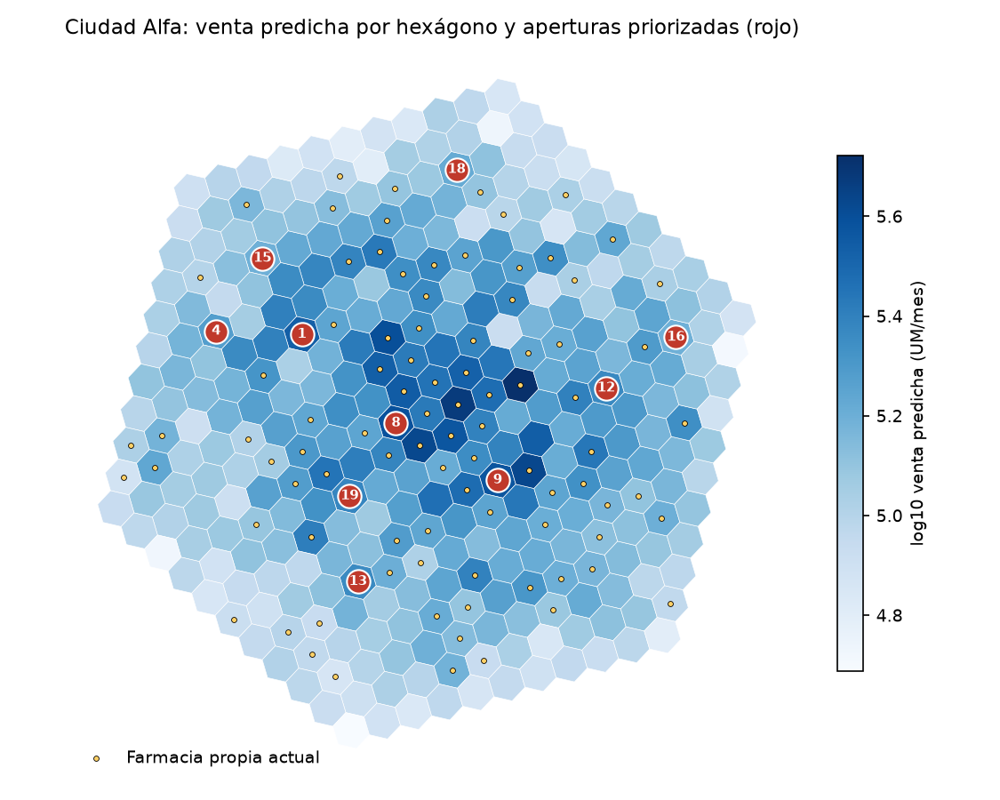
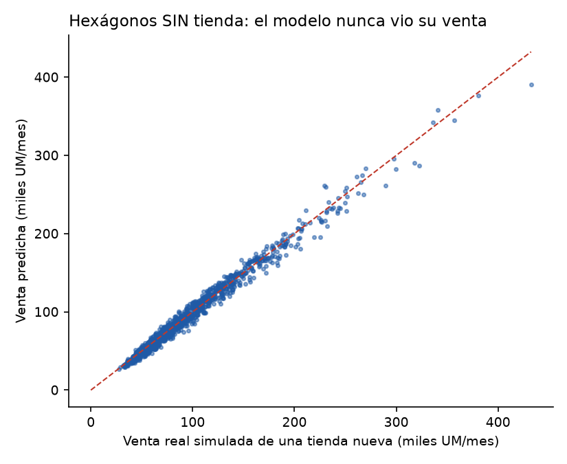

# Expansión retail por hexágonos H3 · sector farmacéutico

Modelo para decidir **dónde abrir la próxima farmacia** de una cadena. Divide el territorio en hexágonos H3, aprende cuánto vende una tienda según la población, el ingreso, los puntos de interés y la competencia de su zona, predice la venta de una apertura en cada hexágono, descuenta la canibalización de las tiendas propias vecinas y entrega una lista corta de aperturas, un ranking de municipios y un mapa interactivo.

> **Datos 100 % sintéticos.** Es la versión de portafolio de un modelo de expansión desarrollado para el retail farmacéutico. "País Demo", sus ciudades (Alfa, Beta, Gamma…), la "Cadena A" y sus competidores son ficticios. El país está ubicado a propósito en mar abierto, así que ninguna celda H3 coincide con un lugar real. Las cifras están en unidades monetarias (UM).

*English summary: an H3-based site-selection model for a pharmacy chain. Spatial features (ring aggregates), a log-sales model validated with municipality-grouped cross-validation, incremental sales with cannibalization, a greedy shortlist with minimum spacing and a self-contained Leaflet map. Data is fully synthetic, with a known ground truth used to check that the model recovers it.*



## Flujo

```
geografia.py     País Demo: 16 ciudades, 44 municipios, ~1.500 hexágonos H3 de resolución 8
      │          población, ingreso per cápita, POIs (salud, comercio, educación),
      │          farmacias propias, Cadena B, Cadena C, independientes y venta por tienda
      ▼
modelo.py        rasgos por anillo H3 (k = 1, 2) → log(venta por tienda)
      │          Ridge log-lineal vs. gradient boosting con restricciones monótonas
      │          validación cruzada AGRUPADA POR MUNICIPIO
      ▼
oportunidad.py   venta de una tienda nueva, venta incremental para la cadena,
      │          canibalización de tiendas propias a 1 y 2 anillos,
      │          lista corta voraz con distancia mínima y ranking de municipios
      ▼
mapa.py          HTML autocontenido con Leaflet
```

## Decisiones de modelado

- **Hexágonos H3 y no municipios.** Un municipio mezcla zonas muy distintas. El hexágono de resolución 8 (~0,7 km²) se acerca al área de influencia de una farmacia de barrio, y los anillos H3 (`grid_ring`) permiten medir la población y la competencia alrededor con una sola línea.
- **Venta por tienda en logaritmo.** La demanda es multiplicativa (población × ingreso × atracción), así que el modelo log-lineal captura las elasticidades directamente.
- **Validación cruzada agrupada por municipio.** Los hexágonos vecinos se parecen. Si se reparten al azar entre entrenamiento y prueba, el error sale optimista. Agrupar por municipio simula lo que pasa al entrar a una zona nueva.
- **Restricciones monótonas** en el gradient boosting. Más población o ingreso nunca bajan la venta, y más competidores o más tiendas propias en el mismo hexágono nunca la suben. Así el modelo no inventa relaciones absurdas donde hay pocos datos.
- **Incremental, no bruta.** Abrir una segunda tienda en un hexágono suma menos de lo que vende esa tienda, porque parte le quita a la primera. La venta incremental se calcula como `(n+1)·ŝ(n+1) − n·ŝ(n)`, y después se descuenta la canibalización de los vecinos (15 % por tienda propia a 1 anillo y 5 % a 2 anillos, con tope de 60 %).
- **Lista corta con distancia mínima.** Las mejores 20 aperturas no pueden quedar a menos de 3 anillos entre sí, para no concentrar todo en un mismo barrio.

## ¿El modelo recupera la verdad?

Como los datos son simulados, se conoce la venta que *realmente* tendría una tienda nueva en cada hexágono. El modelo se entrena solo con los ~260 hexágonos que ya tienen tienda y se evalúa en los ~1.200 que **no** la tienen:

| Métrica | Valor |
| --- | --- |
| R² (log) en validación cruzada por municipio, Ridge | 0,82 |
| R² (log) en validación cruzada por municipio, gradient boosting monótono | 0,75 |
| R² (log) contra la verdad en hexágonos sin tienda | **0,98** |



Los rasgos más importantes (por permutación) son: farmacias propias en el hexágono, población del primer anillo, competidores e ingreso. Eso coincide con los parámetros de la simulación (`geografia.Verdad`).

## Mapa interactivo

[`docs/mapa_expansion.html`](docs/mapa_expansion.html) se abre en cualquier navegador. Si se activa GitHub Pages sobre `/docs`, también queda publicado.

- Tres capas: venta predicha por hexágono, venta neta de una apertura y potencial por municipio.
- Lista corta numerada y farmacias propias actuales.
- Al acercar el zoom, cada hexágono muestra la venta predicha (miles) arriba y las farmacias propias abajo.
- **Clic en los hexágonos** para sumarlos al panel de selección (hexágonos, municipios, población, farmacias, venta) y **exportar la selección a CSV**.

## Uso

```bash
python -m venv .venv
.venv\Scripts\activate            # Linux/macOS: source .venv/bin/activate
pip install -e ".[dev]"

python -m expansion_h3 --semilla 42 --mapa docs/mapa_expansion.html   # todo el flujo
python scripts/generar_figuras.py                                     # figuras del README
pytest
```

Salidas en `salidas/`: `hexagonos.csv`, `lista_corta.csv`, `ranking_municipios.csv` y `metricas.json`.

## Con datos reales

El esquema de `salidas/hexagonos.csv` es el contrato. Para un caso real se reemplaza `generar_pais` por un lector que arme la misma tabla con:

- **población** por hexágono, a partir de un censo o de grillas públicas de población;
- **POIs** de OpenStreetMap;
- **ingreso** por municipio;
- **red de tiendas y competidores** geocodificada;
- **venta mensual** por tienda.

El resto del flujo no cambia.

## Límites

- **Sesgo de selección.** Las tiendas actuales están donde ya había más demanda, así que el modelo extrapola hacia zonas más pobres o despobladas. En la simulación el error es bajo porque la forma funcional es correcta; con datos reales conviene validar con aperturas recientes.
- **Supuesto de la canibalización entre vecinos.** Es una regla de negocio, no algo estimado.
- **Sin costos.** No modela arriendo, inversión ni rentabilidad: el ranking es por venta incremental.
